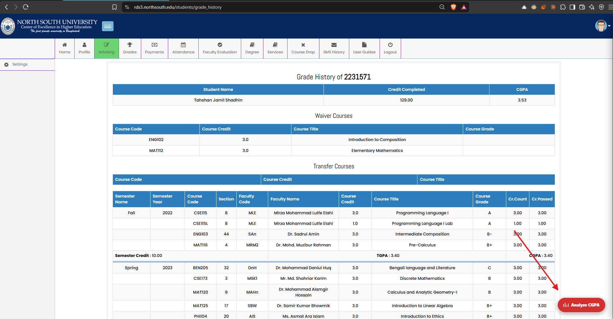
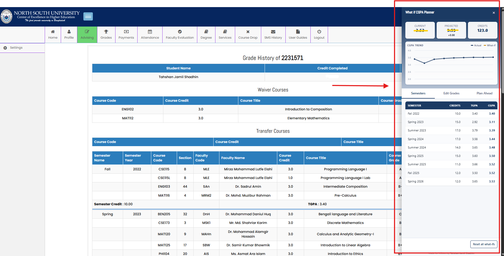
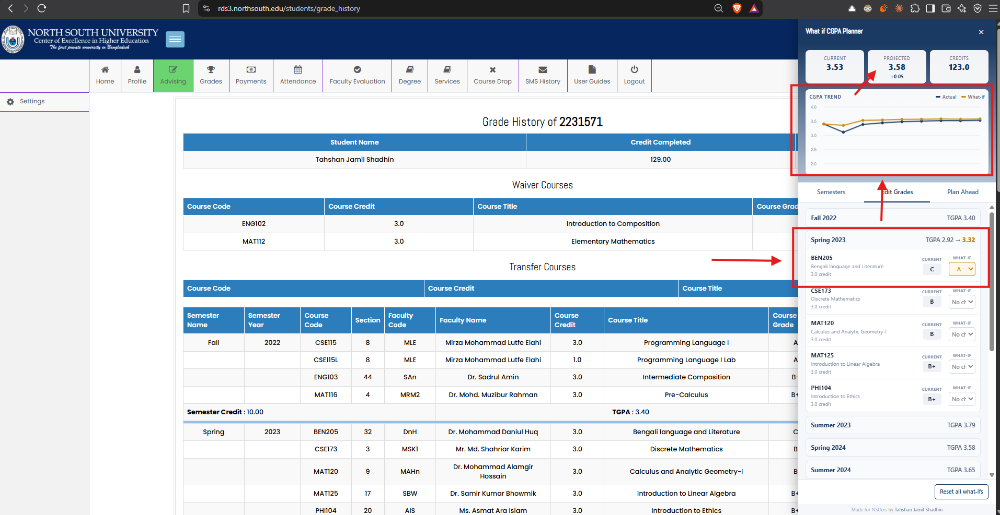
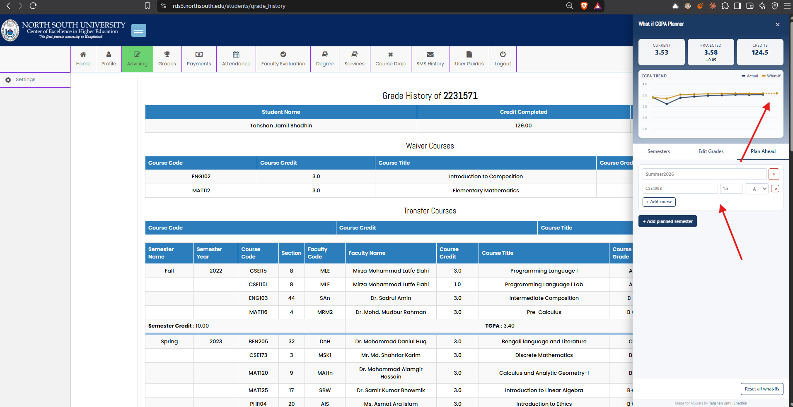
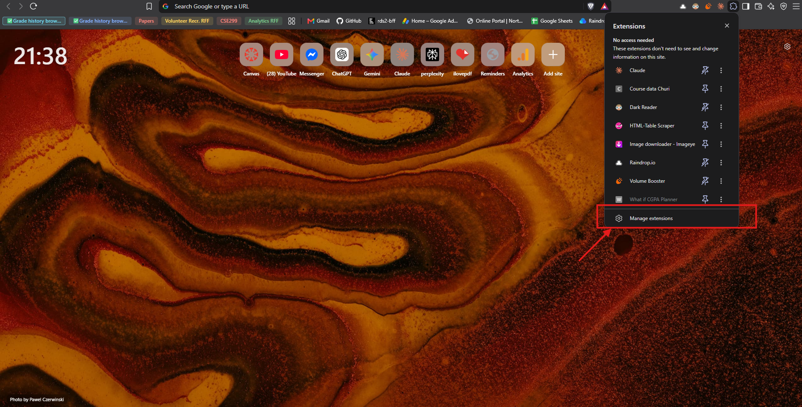
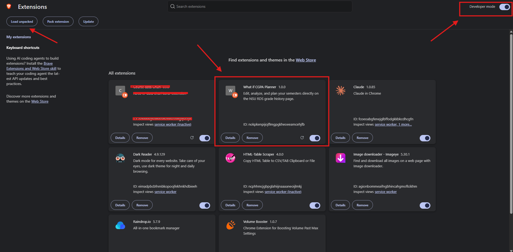

# What if CGPA for NSUers

**[⬇ Get it on the Chrome Web Store](https://chromewebstore.google.com/detail/koekeocjmjcbinjpfpijockklageaknd?utm_source=item-share-cb)**

A Chrome extension for North South University students. It turns your RDS **Grade History** page into a live CGPA calculator and "what-if" planner, adds a quick-glance widget for today's classes and attendance, and gives you a student dashboard on every new tab. None of it touches your real academic record.

The CGPA planner and Mini-RDS3 only activate on NSU RDS3 pages: the planner on `rds3.northsouth.edu/students/grade_history`, and Mini-RDS3 on that page plus the `landing` page. The new tab dashboard replaces Chrome's new tab page.

This is an **open-source, community project**, built for NSU students by an NSU student. Contributions, bug reports, and feature ideas are very welcome. See [Contributing](#contributing) below.

## What's new in 2.6.0

- **New name and icon:** now "What if CGPA for NSUers".
- **Exclude courses:** remove any course (and every retake of it) from your CGPA with the × button in Edit Grades. The row turns gray, and + adds it back.
- **Smarter, friendlier charts:** hover tooltips, semester labels, an honors zone on the trend chart, short tips under each chart (best semester, credits of A's needed for honors, and more), and a small celebration when a what-if reaches a new honors level. Charts now follow dark themes too.
- **Bangladesh wallpapers and categories:** 8 new photos of Bangladesh for the new tab, with every wallpaper sorted into categories (Bangladesh, Landscapes, Plants & Flowers, Animals, Art & Abstract, Illustrations).
- **Shuffle by category:** pick which categories to shuffle, and press Next for a fresh wallpaper.
- **Redesigned Customize panel:** Wallpaper, Colors, Clock, Search Bar and Dashboard groups, each showing its current setting.
- **Built-in help:** the toolbar popup is now a quick-start guide, a features tour and a Q&A.
- **NSUmate links:** NSUmate replaces the old RDS2 link, and new tab links open in the same tab.
- **Line icons instead of emoji** throughout, for a cleaner look on every OS.

## Gallery

| | |
|---|---|
|  |  |
| The floating button appears only on the grade history page | Semesters tab: trend chart, honors badge, per-semester TGPA/CGPA |
|  |  |
| Edit Grades: change a grade, see the TGPA update and the what-if line appear on the chart | Plan Ahead: add a hypothetical future semester and course |

## Why

The official grade history page shows you your CGPA, but it's static. Students constantly ask "what if I retake this course and get an A?" or "what CGPA do I need to graduate with honors?", and end up doing the math by hand or in a spreadsheet. This extension answers those questions right on the page you already use.

## Features

### CGPA planner (Grade History page)

- **Analyze CGPA button:** opens a side panel with everything below.
- **Charts:** CGPA trend, grade distribution, semester GPA and credits per semester. Hover any point or bar for details, and read short tips under each chart.
- **What-if grade editor:** change any past course's grade and watch semester TGPA and cumulative CGPA recalculate instantly. A second line on the chart compares your real trajectory with the edited one.
- **Exclude courses:** leave a course and all its retakes out of the CGPA, and add it back any time.
- **Plan Ahead:** add future semesters and courses with expected grades to project where your CGPA is heading.
- **Target CGPA:** enter a goal and see whether retakes can get you there, and which courses to retake first.
- **Retake handling:** when a course code appears more than once, only the best attempt counts toward CGPA and credits, matching the official rules.
- **Latin honors tracking:** shows whether your current or projected CGPA reaches Cum Laude (3.50–3.64), Magna Cum Laude (3.65–3.79) or Summa Cum Laude (3.80–4.00).

### Mini-RDS3 (RDS3 home and Grade History)

- Today's classes with times and rooms, your full weekly routine, and whether you were marked present in each course's last class.

### New tab dashboard

- Your CGPA journey, today's classes, attendance and routine.
- To-do list, weekly to-do planner and a focus timer.
- Quick links to RDS3, Canvas, NSU notices and NSUmate, plus your own favorite links.
- Optional search bar that uses your default search engine.
- **Customize** (pencil button): wallpapers by category or shuffle, 14 light and dark color themes, clock font and size, search bar style, and which sections show (or a minimal mode).

### Toolbar popup

- A quick-start guide, a tour of every feature, and answers to common questions.

## How it works

The extension is made up of independent parts, all declared in `manifest.json`:

- **CGPA planner** (`content.js` + `content.css`), injected only into the grade history page. It:
  1. Parses the existing HTML grade table directly from the DOM (no API calls, no scraping elsewhere).
  2. Recomputes TGPA/CGPA using NSU's official grading scale:

     | Grade | Points | Grade | Points | Grade | Points |
     |-------|--------|-------|--------|-------|--------|
     | A     | 4.0    | B     | 3.0    | C-    | 1.7    |
     | A-    | 3.7    | B-    | 2.7    | D+    | 1.3    |
     | B+    | 3.3    | C+    | 2.3    | D     | 1.0    |
     |       |        | C     | 2.0    | F     | 0.0    |

     (`W` and `I` are excluded from GPA calculations, as they are officially.)
  3. Renders a floating panel with the charts, a per-semester breakdown, the grade editor, the semester planner and the target calculator.

  The math has been verified against real transcripts: recomputed CGPA and per-semester TGPA match the official values exactly.

- **Mini-RDS3** (`mini-rds3.js` + `mini-rds3.css`), injected into the landing page and the grade history page. It detects your current semester, fetches your registered courses and per-course attendance from your own RDS3 session (same-origin requests only, cached for a few minutes), and shows them in a floating "Today" / "Full Routine" widget.

- **New tab dashboard** (`newtab.html`, `newtab.js`, `newtab.css`), Chrome's new tab override. It reads the grades and routine the other two parts cache in `chrome.storage.local` when you visit RDS3.

- **Popup** (`popup.html` + `popup.js`): the help guide behind the toolbar button.

## Installation

**[Install it from the Chrome Web Store](https://chromewebstore.google.com/detail/koekeocjmjcbinjpfpijockklageaknd?utm_source=item-share-cb)**. This is the recommended way to get the extension.

To run a development build instead (e.g. to test a change before it's published), load it unpacked:

1. Clone or download this repository.
2. Click the puzzle-piece icon in Chrome's toolbar and choose **Manage extensions** to open `chrome://extensions`.

   

3. Enable **Developer mode** (top-right toggle) and click **Load unpacked**, then select the project folder you cloned/downloaded. Once loaded, it'll show up in your extensions list like this:

   

4. Visit your grade history page at `rds3.northsouth.edu/students/grade_history`. The "Analyze CGPA" button appears in the bottom-right corner.

## Privacy

- There is no backend and no third-party data sharing. The CGPA planner and Mini-RDS3 only talk to `rds3.northsouth.edu`, using your own logged-in session, to read your grades, routine and attendance.
- Your grades, what-if edits, excluded courses and planned semesters are stored only in your own browser (`chrome.storage.local`), keyed to your student ID so multiple students on a shared computer don't see each other's plans.
- The new tab page loads public assets only: wallpaper photos from Unsplash, link icons from Google's favicon service, and clock fonts from Google Fonts. None of these requests include your data.
- The extension sends anonymous, aggregated usage events (e.g. which panel or tab was opened) to Google Analytics via a write-only Measurement Protocol key, purely to understand feature usage. No grades, course data or personally identifying information are included.
- Uninstalling the extension or clearing its data removes everything it stored.

## Contributing

Pull requests, issues, and ideas are all welcome. This is meant to be a community tool for NSU students. Some ideas if you're looking for a place to start:

- Export/print the what-if plan
- Support for waiver/transfer credits in the CGPA math
- A Firefox port

To contribute: fork the repo, make your changes (`content.js`/`content.css` for the CGPA planner, `mini-rds3.js`/`mini-rds3.css` for Mini-RDS3, `newtab.*` for the new tab dashboard, `popup.*` for the help popup, or `manifest.json`), test by loading it unpacked, and open a PR.

## License

MIT, see [LICENSE](LICENSE). Do whatever you want with this, just keep the license notice.

## Credits

Made for NSUers by **[Tahshan Jamil Shadhin](https://www.linkedin.com/in/tahshan-jamil-shadhin/)** · [nsumate.com](https://nsumate.com/)
